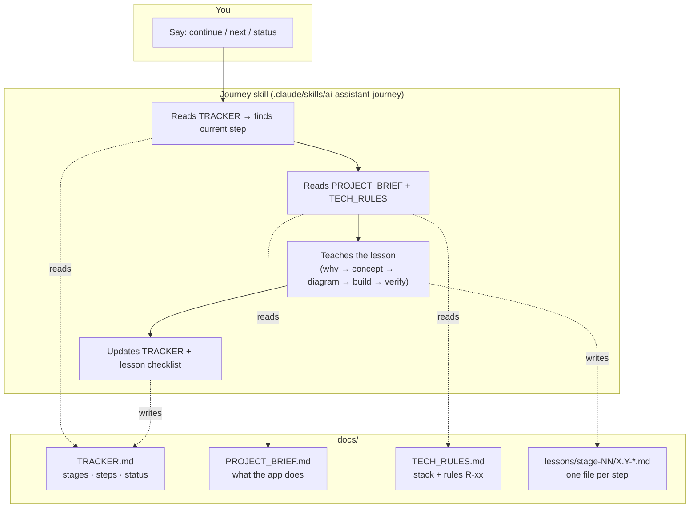
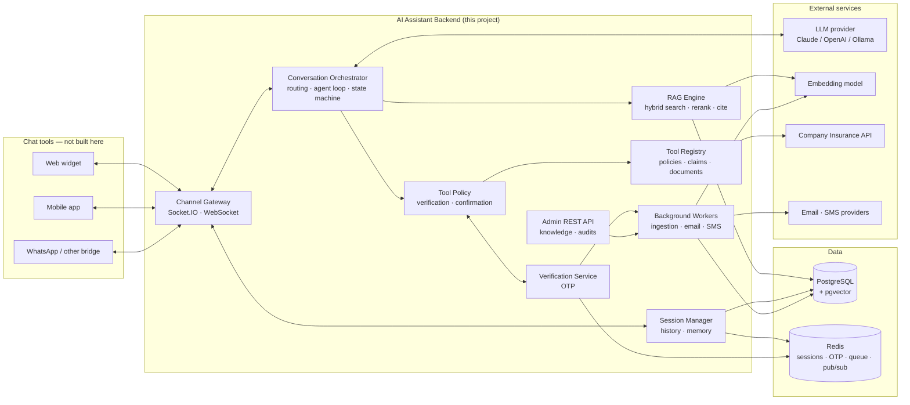
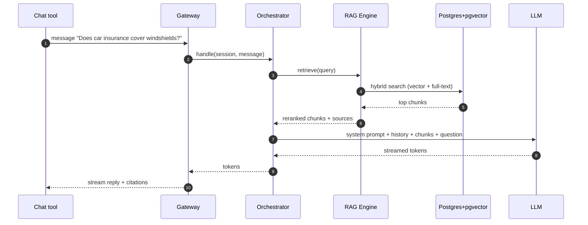
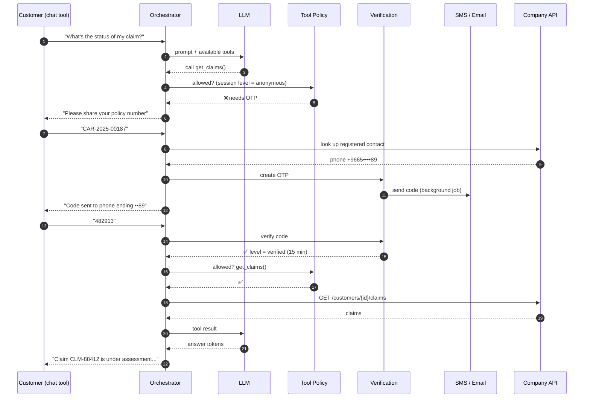
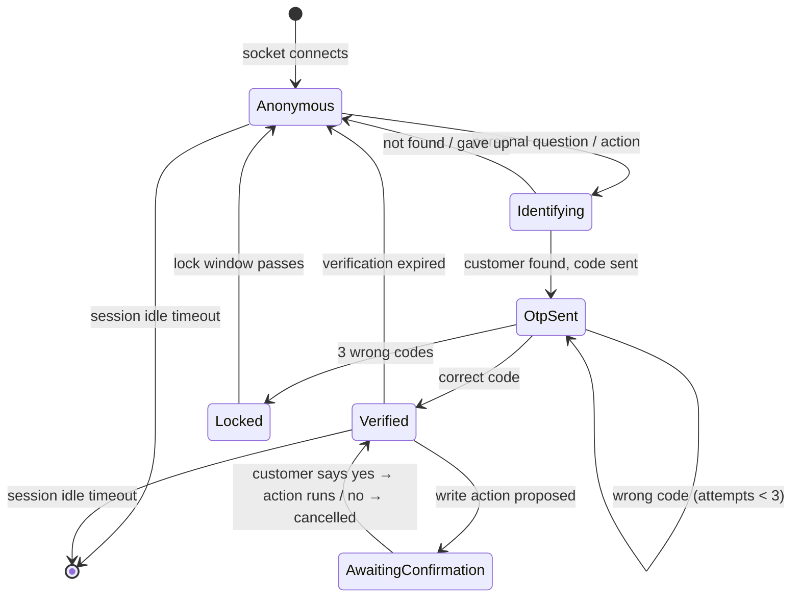
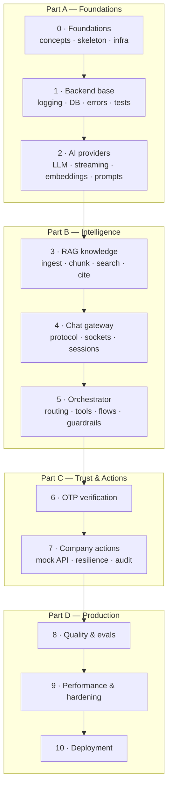

# Guide — Building a Production AI Assistant for an Insurance Company

> Start here. This file explains **what** we are building, **how the journey works**, and gives you the
> **architecture map** that every lesson zooms into.

---

## 1. What you will build

A **backend service** that powers an AI customer assistant:

- 💬 Any chat tool (web widget, mobile app, WhatsApp bridge...) connects to it over a **socket**.
- 📚 It answers product and procedure questions from the company's documents using **RAG**.
- 🔐 It verifies the customer with an **OTP over SMS/email** before showing personal data.
- 🛠️ It performs **actions** (check claims, submit a claim, email a policy) by calling the **company API**.
- 🧠 It keeps **sessions** and conversation memory, streams answers, and scales horizontally.

At the end of the journey you have a tested, observable, containerized app ready for production.

## 2. How the journey works



| File | Purpose |
|------|---------|
| [GUIDE.md](GUIDE.md) | This overview + architecture map |
| [TRACKER.md](TRACKER.md) | **Where you are.** All stages/steps with status, decisions log |
| [PROJECT_BRIEF.md](PROJECT_BRIEF.md) | **What** the app does — edit it to change the business scope |
| [TECH_RULES.md](TECH_RULES.md) | **How** it is built — stack and engineering rules (`R-xx`) |
| [lessons/](lessons/) | One Markdown lesson per step, kept forever as your notes |
| `.claude/skills/ai-assistant-journey/` | The tutor's rules — lets you resume from any stage in a new session |

**To resume anytime:** open Claude Code in this folder and say **"continue the journey"**
(or type `/ai-assistant-journey`). Other useful phrases: *"status"*, *"start step 3.2"*,
*"explain again"*, *"quiz me"*, *"change rule R-xx to ..."*.

**Every lesson has:** 🎯 Goal · 🤔 Why · 🧠 Concepts · 🗺️ Diagram · 🛠️ Build · ✅ Verify ·
⚠️ Production notes · 🧪 Exercise · 💭 Reflection · ☑️ Checklist.

**Status legend:** ⬜ Not started · 🟨 In progress · ✅ Done · ⏭️ Skipped · 🔁 Needs revisit

> 💡 **Viewing diagrams in VS Code:** install the extension *"Markdown Preview Mermaid Support"*
> (`bierner.markdown-mermaid`), then open any `.md` file and press `Ctrl+Shift+V`. GitHub renders them natively.

## 3. Architecture map



| Component | Responsibility | Built in stage |
|-----------|----------------|----------------|
| Channel Gateway | Socket connections, auth, event protocol, streaming | 4 |
| Session Manager | Session lifecycle, history, memory, expiry | 4 |
| Conversation Orchestrator | Decides what to do per message; runs the LLM ↔ tools loop | 5 |
| RAG Engine | Ingest, chunk, embed, retrieve, rerank, answer with citations | 3 |
| Verification Service | Customer identification, OTP send/verify, verification levels | 6 |
| Tool Policy | Enforces "verified?" and "confirmed?" **in code** before any tool runs | 6 |
| Tool Registry | Typed tools that call the company API | 7 |
| Admin REST API | Knowledge upload/reindex, audit queries, health | 3, 7 |
| Background Workers | Ingestion, email, SMS — off the request path | 3, 6 |
| AI provider adapters | Swappable LLM + embedding clients | 2 |

### The golden rule
> **The LLM proposes, the code decides.** The model may *ask* to call `get_claim_status`, but the
> Tool Policy checks the session's verification level and blocks it if the customer has not passed OTP.
> Prompts are guidance, not security.

## 4. The three core flows

### 4.1 Knowledge question (RAG) — no verification needed


### 4.2 Personal question — OTP first


### 4.3 Session & verification lifecycle


## 5. Journey map



Full step list with status: **[TRACKER.md](TRACKER.md)**.

## 6. Target repository layout

```
mini-rag/
├─ .claude/skills/ai-assistant-journey/   # tutor skill (resume from any stage)
├─ app/                                   # the backend (layout in TECH_RULES.md §2)
├─ mock_company_api/                      # fake insurance API for development
├─ tests/                                 # unit · integration · e2e · evals
├─ docker/                                # compose + Dockerfiles
├─ docs/
│  ├─ GUIDE.md · TRACKER.md · PROJECT_BRIEF.md · TECH_RULES.md
│  ├─ protocol/                           # socket event contract (stage 4)
│  └─ lessons/stage-NN-*/X.Y-*.md         # one lesson per step
├─ pyproject.toml · uv.lock · .env.example
```
