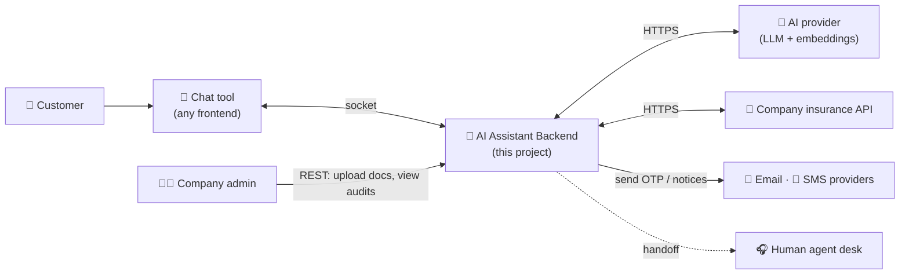

# Project Brief — Insurance AI Assistant (Backend)

> **This is the "what" of the app.** You own this file: change it whenever the business idea changes.
> The "how" (stack and engineering rules) lives in [TECH_RULES.md](TECH_RULES.md).
> Lines marked **(assumption)** are my best guesses — confirm or edit them.

---

## 1. Vision

A backend service that powers an **AI customer assistant for an insurance company**.
Customers chat through any chat tool (web widget, mobile app, WhatsApp bridge, etc.).
The assistant:

1. **Answers general questions** about the company's products and procedures using the company's own
   documents (RAG) — accurately, with sources, and says "I don't know" instead of inventing.
2. **Answers personal questions** (my policy, my claims) after verifying the customer's identity with an
   **OTP** sent by SMS or email.
3. **Performs actions** in the company's systems (via the company API) after OTP verification **and**
   explicit confirmation from the customer.
4. **Hands off to a human** agent when it can't help or the customer asks for one.

This project is **only the backend**. The chat UI is someone else's job — it connects to us over a socket.

## 2. Actors

| Actor | Role |
|-------|------|
| Customer | Asks questions, requests actions, enters OTP codes |
| Chat tool (frontend) | Connects to our socket, relays messages and streamed replies. Can be cloud or local. |
| Company admin | Uploads/updates knowledge documents, views audit logs and conversation analytics |
| AI provider | External LLM for reasoning/answers, plus an embedding model for RAG |
| Company insurance API | System of record: customers, policies, claims, payments |
| Email / SMS providers | Deliver OTP codes and confirmations |
| Human agent desk | Receives conversations the bot hands off (assumption: via webhook/queue) |

## 3. Capabilities

### 3.1 Public (no verification)
- Product information: car, home, health, travel insurance (assumption) — coverage, exclusions, add-ons.
- Procedures: how to file a claim, required documents, timelines, branch hours, contact channels.
- General insurance questions (deductible, premium, no-claims bonus...).
- Answers come from the **knowledge base** with source citations.

### 3.2 Personal — read (requires OTP)
| Capability | Example | Company API (draft) |
|------------|---------|---------------------|
| List my policies | "What policies do I have?" | `GET /customers/{id}/policies` |
| Policy details | "When does my car policy expire?" | `GET /policies/{policy_no}` |
| Claims list / status | "What's the status of my claim?" | `GET /customers/{id}/claims`, `GET /claims/{claim_no}` |
| Payments due | "How much is my next premium?" | `GET /policies/{policy_no}/payments` |

### 3.3 Personal — actions (requires OTP **and** confirmation)
| Action | Example | Company API (draft) |
|--------|---------|---------------------|
| Submit a claim (FNOL) | "I had an accident yesterday" | `POST /claims` |
| Send policy document | "Email me my policy PDF" | `POST /policies/{policy_no}/documents/send` |
| Update contact details | "Change my email" | `PATCH /customers/{id}/contact` (step-up OTP to the *old* channel) |
| Request a callback | "Call me tomorrow" | `POST /callbacks` |

> During development we build a **mock company API** with these endpoints; swapping it for the real one is configuration.

### 3.4 Verification flow (business rules)
- The customer identifies themselves (policy number, or national ID + date of birth — assumption).
- We look up their registered phone/email in the company API — **never** a number the customer types in chat.
- We send a 6-digit OTP: valid **5 minutes**, max **3 attempts**, max **3 sends per 15 min** (assumption).
- Verification lasts for the session, max **15 minutes idle / 60 minutes total** (assumption).
- Sensitive actions (changing contact details) need a fresh OTP (step-up).

### 3.5 Sessions
- Each chat tool connection carries a `session_id`; a customer can reconnect and continue.
- Conversation history is kept so the assistant remembers context.
- Sessions expire after inactivity; history is stored for audit/analytics according to retention policy.

### 3.6 Human handoff
- Triggered by: customer request, repeated failure to help, complaints, or sensitive topics.
- The conversation summary is passed to the human desk.

## 4. Non-functional requirements

| Area | Target |
|------|--------|
| Latency | First streamed token **< 1.5 s p95** for knowledge answers (assumption) |
| Concurrency | **1,000+ concurrent sessions** per deployment, horizontally scalable (assumption) |
| Availability | Degrades gracefully: if the company API is down, the assistant says so and still answers public questions |
| Accuracy | Knowledge answers must be grounded in retrieved documents, with citations |
| Security | OTP before personal data; no PII in logs; secrets in env/secret manager; full audit trail |
| Languages | **English + Arabic** (assumption) — affects embedding model and prompts |
| Cost | Token usage tracked per session/day; cheap model for routing, stronger model for answers |
| Portability | Any chat tool can integrate via a documented socket protocol |

## 5. Out of scope
- Building the chat UI (we only build a tiny HTML test client for development).
- Payments processing inside the chat.
- Training/fine-tuning models.

## 6. Example conversations

**Public question**
> **Customer:** Does comprehensive car insurance cover windshield damage?
> **Assistant:** Yes — comprehensive car policies cover windshield repair or replacement with no deductible for the first claim per year. *(Source: Car Insurance Guide, §4.2)*

**Personal question with OTP**
> **Customer:** What's the status of my claim?
> **Assistant:** I can check that for you. For your security, please share your policy number.
> **Customer:** CAR-2025-00187
> **Assistant:** Thanks. I've sent a 6-digit code to your phone ending in ••89. Please enter it here.
> **Customer:** 482913
> **Assistant:** Verified ✅. Your claim **CLM-88412** (rear bumper damage) is *Under assessment*; the surveyor visit is scheduled for 28 Oct.

**Action with confirmation**
> **Customer:** Please email me my policy document.
> **Assistant:** I'll send the PDF of policy CAR-2025-00187 to your registered email i•••@gmail.com. Shall I proceed? (yes/no)
> **Customer:** yes
> **Assistant:** Done — sent. Reference: DOC-55120.

## 7. Open questions (fill in as you learn more)
- [ ] Which identifiers does the real company API accept for customer lookup?
- [ ] Which SMS/email providers does the company already use?
- [ ] Data retention period for chat transcripts?
- [ ] Which human-agent desk tool (if any) receives handoffs?
