# Journey Tracker

> The tutor updates this file at every status change. To resume, just say **"continue"**
> (or run `/ai-assistant-journey`).

## 📍 Current position

| Field | Value |
|-------|-------|
| Stage | 0 — Foundations & Big Picture |
| Step | **0.1 — The big picture: architecture & request flows** |
| Status | ⬜ Not started |
| Steps done | 0 / 50 |
| Last updated | 2026-10-26 |
| Next action | Start lesson 0.1 |

**Legend:** ⬜ Not started · 🟨 In progress · ✅ Done · ⏭️ Skipped · 🔁 Needs revisit

## 🗺️ Stage map

```mermaid
flowchart LR
    S0["0 · Foundations"] --> S1["1 · Backend base"] --> S2["2 · AI providers"] --> S3["3 · RAG knowledge"]
    S3 --> S4["4 · Chat gateway"] --> S5["5 · Orchestrator"] --> S6["6 · OTP verification"]
    S6 --> S7["7 · Company actions"] --> S8["8 · Quality & evals"] --> S9["9 · Performance & hardening"] --> S10["10 · Production"]

    classDef todo fill:#eee,stroke:#999,color:#333
    classDef doing fill:#fff3c4,stroke:#d4a000,color:#333
    classDef done fill:#d4f7d4,stroke:#2e8b57,color:#333
    class S0,S1,S2,S3,S4,S5,S6,S7,S8,S9,S10 todo
```

*(The tutor recolors nodes as stages progress: `todo` → `doing` → `done`.)*

## 📊 Progress by stage

| # | Stage | Steps | Done | Status |
|---|-------|-------|------|--------|
| 0 | Foundations & Big Picture | 4 | 0 | ⬜ |
| 1 | Backend Foundation | 4 | 0 | ⬜ |
| 2 | AI Provider Layer | 4 | 0 | ⬜ |
| 3 | RAG Knowledge Base | 7 | 0 | ⬜ |
| 4 | Realtime Chat Gateway | 5 | 0 | ⬜ |
| 5 | Conversation Orchestrator | 5 | 0 | ⬜ |
| 6 | Identity Verification (OTP) | 4 | 0 | ⬜ |
| 7 | Company API Actions | 5 | 0 | ⬜ |
| 8 | Quality & Evaluation | 3 | 0 | ⬜ |
| 9 | Performance & Hardening | 5 | 0 | ⬜ |
| 10 | Production Deployment | 4 | 0 | ⬜ |
| | **Total** | **50** | **0** | |

---

## Stage 0 — Foundations & Big Picture ⬜
*Understand what we build and why, set up the project and local infrastructure.*

| Step | Title | Status | Lesson | Done on |
|------|-------|--------|--------|---------|
| 0.1 | The big picture: architecture & request flows | ⬜ | [lesson](lessons/stage-00-foundations/0.1-big-picture.md) | |
| 0.2 | AI concepts for engineers: LLM, tokens, embeddings, RAG, tool calling | ⬜ | [lesson](lessons/stage-00-foundations/0.2-ai-concepts.md) | |
| 0.3 | Project skeleton: uv, FastAPI, settings, folder layout | ⬜ | [lesson](lessons/stage-00-foundations/0.3-project-skeleton.md) | |
| 0.4 | Local infrastructure with Docker Compose (Postgres+pgvector, Redis, Mailpit) | ⬜ | [lesson](lessons/stage-00-foundations/0.4-local-infrastructure.md) | |

## Stage 1 — Backend Foundation ⬜
*A solid, observable, testable FastAPI service before any AI.*

| Step | Title | Status | Lesson | Done on |
|------|-------|--------|--------|---------|
| 1.1 | App factory, structured logging, request IDs, health checks | ⬜ | [lesson](lessons/stage-01-backend-foundation/1.1-app-factory-logging.md) | |
| 1.2 | Database layer: async SQLAlchemy, Alembic, first migration | ⬜ | [lesson](lessons/stage-01-backend-foundation/1.2-database-layer.md) | |
| 1.3 | Error handling & API conventions | ⬜ | [lesson](lessons/stage-01-backend-foundation/1.3-errors-conventions.md) | |
| 1.4 | Testing foundation: pytest, fixtures, fake adapters | ⬜ | [lesson](lessons/stage-01-backend-foundation/1.4-testing-foundation.md) | |

## Stage 2 — AI Provider Layer ⬜
*Talk to LLMs and embedding models through swappable interfaces.*

| Step | Title | Status | Lesson | Done on |
|------|-------|--------|--------|---------|
| 2.1 | LLM port & first adapter (Claude) + fake adapter | ⬜ | [lesson](lessons/stage-02-ai-providers/2.1-llm-port.md) | |
| 2.2 | Streaming tokens & multi-provider factory (OpenAI, Ollama) | ⬜ | [lesson](lessons/stage-02-ai-providers/2.2-streaming-multi-provider.md) | |
| 2.3 | Embedding port & multilingual adapters | ⬜ | [lesson](lessons/stage-02-ai-providers/2.3-embeddings.md) | |
| 2.4 | Prompt management: system prompt, templates, versions | ⬜ | [lesson](lessons/stage-02-ai-providers/2.4-prompt-management.md) | |

## Stage 3 — RAG Knowledge Base ⬜
*Turn company documents into accurate, cited answers.*

| Step | Title | Status | Lesson | Done on |
|------|-------|--------|--------|---------|
| 3.1 | Document loading & cleaning (PDF, DOCX, HTML, MD) | ⬜ | [lesson](lessons/stage-03-rag/3.1-document-loading.md) | |
| 3.2 | Chunking strategies & metadata | ⬜ | [lesson](lessons/stage-03-rag/3.2-chunking.md) | |
| 3.3 | Vector store: pgvector schema, HNSW index, upserts | ⬜ | [lesson](lessons/stage-03-rag/3.3-vector-store.md) | |
| 3.4 | Retrieval: semantic search with metadata filters | ⬜ | [lesson](lessons/stage-03-rag/3.4-retrieval.md) | |
| 3.5 | Hybrid search (full-text + vector) & reranking | ⬜ | [lesson](lessons/stage-03-rag/3.5-hybrid-rerank.md) | |
| 3.6 | Grounded answers with citations & "I don't know" | ⬜ | [lesson](lessons/stage-03-rag/3.6-grounded-answers.md) | |
| 3.7 | Knowledge admin API + background ingestion jobs | ⬜ | [lesson](lessons/stage-03-rag/3.7-knowledge-admin-ingestion.md) | |

## Stage 4 — Realtime Chat Gateway ⬜
*Any chat tool connects over a socket; sessions survive reconnects.*

| Step | Title | Status | Lesson | Done on |
|------|-------|--------|--------|---------|
| 4.1 | Socket event protocol (contract v1) | ⬜ | [lesson](lessons/stage-04-chat-gateway/4.1-event-protocol.md) | |
| 4.2 | Socket.IO + plain WebSocket gateways & dev test client | ⬜ | [lesson](lessons/stage-04-chat-gateway/4.2-socket-gateways.md) | |
| 4.3 | Client authentication & rate limiting | ⬜ | [lesson](lessons/stage-04-chat-gateway/4.3-auth-rate-limit.md) | |
| 4.4 | Sessions & conversation memory (Redis + Postgres) | ⬜ | [lesson](lessons/stage-04-chat-gateway/4.4-sessions-memory.md) | |
| 4.5 | Streaming replies, acks, reconnection & multi-worker scaling | ⬜ | [lesson](lessons/stage-04-chat-gateway/4.5-streaming-scaling.md) | |

## Stage 5 — Conversation Orchestrator ⬜
*The brain: decide what to do with each message and drive multi-turn flows.*

| Step | Title | Status | Lesson | Done on |
|------|-------|--------|--------|---------|
| 5.1 | Orchestrator loop: from message to answer (RAG path) | ⬜ | [lesson](lessons/stage-05-orchestrator/5.1-orchestrator-loop.md) | |
| 5.2 | Intent routing: knowledge vs personal vs action vs handoff | ⬜ | [lesson](lessons/stage-05-orchestrator/5.2-intent-routing.md) | |
| 5.3 | Tool calling: tool registry, schemas & the agent loop | ⬜ | [lesson](lessons/stage-05-orchestrator/5.3-tool-calling.md) | |
| 5.4 | Conversation state machine (multi-turn flows, slot filling) | ⬜ | [lesson](lessons/stage-05-orchestrator/5.4-state-machine.md) | |
| 5.5 | Guardrails: prompt injection, off-topic, output checks | ⬜ | [lesson](lessons/stage-05-orchestrator/5.5-guardrails.md) | |

## Stage 6 — Identity Verification (OTP) ⬜
*No personal data or action without proof of identity.*

| Step | Title | Status | Lesson | Done on |
|------|-------|--------|--------|---------|
| 6.1 | Customer identification & verification levels | ⬜ | [lesson](lessons/stage-06-verification/6.1-identification-levels.md) | |
| 6.2 | OTP service: generate, hash, TTL, attempt & send limits | ⬜ | [lesson](lessons/stage-06-verification/6.2-otp-service.md) | |
| 6.3 | Notification adapters: email & SMS via background jobs | ⬜ | [lesson](lessons/stage-06-verification/6.3-notifications.md) | |
| 6.4 | Tool policy enforcement: gated tools, step-up, expiry | ⬜ | [lesson](lessons/stage-06-verification/6.4-tool-policy.md) | |

## Stage 7 — Company API Actions ⬜
*Real work in the company's systems — safely.*

| Step | Title | Status | Lesson | Done on |
|------|-------|--------|--------|---------|
| 7.1 | Mock insurance company API (customers, policies, claims) | ⬜ | [lesson](lessons/stage-07-company-actions/7.1-mock-company-api.md) | |
| 7.2 | Resilient API client: timeouts, retries, circuit breaker | ⬜ | [lesson](lessons/stage-07-company-actions/7.2-resilient-client.md) | |
| 7.3 | Read tools: policies, claims, payments | ⬜ | [lesson](lessons/stage-07-company-actions/7.3-read-tools.md) | |
| 7.4 | Write tools with confirmation & idempotency | ⬜ | [lesson](lessons/stage-07-company-actions/7.4-write-tools.md) | |
| 7.5 | Audit log & human handoff | ⬜ | [lesson](lessons/stage-07-company-actions/7.5-audit-handoff.md) | |

## Stage 8 — Quality & Evaluation ⬜
*Prove it works, and keep proving it.*

| Step | Title | Status | Lesson | Done on |
|------|-------|--------|--------|---------|
| 8.1 | RAG evaluation set & retrieval/answer metrics | ⬜ | [lesson](lessons/stage-08-quality/8.1-rag-evaluation.md) | |
| 8.2 | End-to-end conversation tests | ⬜ | [lesson](lessons/stage-08-quality/8.2-e2e-conversations.md) | |
| 8.3 | Feedback loop & conversation analytics | ⬜ | [lesson](lessons/stage-08-quality/8.3-feedback-analytics.md) | |

## Stage 9 — Performance & Hardening ⬜
*Fast, cheap, observable, secure.*

| Step | Title | Status | Lesson | Done on |
|------|-------|--------|--------|---------|
| 9.1 | Caching: query embeddings, retrieval, prompt caching | ⬜ | [lesson](lessons/stage-09-hardening/9.1-caching.md) | |
| 9.2 | Context management: summarization, token budgets, cost tracking | ⬜ | [lesson](lessons/stage-09-hardening/9.2-context-cost.md) | |
| 9.3 | Observability: metrics, tracing, LLM telemetry | ⬜ | [lesson](lessons/stage-09-hardening/9.3-observability.md) | |
| 9.4 | Security hardening: PII masking, secrets, retention, threat review | ⬜ | [lesson](lessons/stage-09-hardening/9.4-security.md) | |
| 9.5 | Load testing & tuning | ⬜ | [lesson](lessons/stage-09-hardening/9.5-load-testing.md) | |

## Stage 10 — Production Deployment ⬜
*Ship it.*

| Step | Title | Status | Lesson | Done on |
|------|-------|--------|--------|---------|
| 10.1 | Production Docker image & process model | ⬜ | [lesson](lessons/stage-10-production/10.1-docker-image.md) | |
| 10.2 | CI pipeline: lint, types, tests, evals | ⬜ | [lesson](lessons/stage-10-production/10.2-ci-pipeline.md) | |
| 10.3 | Deployment, migrations & environment configs | ⬜ | [lesson](lessons/stage-10-production/10.3-deployment.md) | |
| 10.4 | Launch checklist & runbook | ⬜ | [lesson](lessons/stage-10-production/10.4-launch-runbook.md) | |

---

## 📝 Decisions log

| Date | Decision | Reason |
|------|----------|--------|
| 2026-10-26 | Journey created: 11 stages / 50 steps; initial stack per TECH_RULES.md (Python 3.12, FastAPI, Socket.IO, Postgres+pgvector, Redis, arq, provider-agnostic LLM) | Production-grade defaults with the strongest RAG ecosystem; every part is swappable |

## 🗒️ Session notes
*(Short notes the tutor adds at the end of a session: open questions, things to revisit.)*

- 2026-10-26 — Journey set up. Before step 0.3, review the **(assumption)** lines in PROJECT_BRIEF.md and the stack in TECH_RULES.md.
